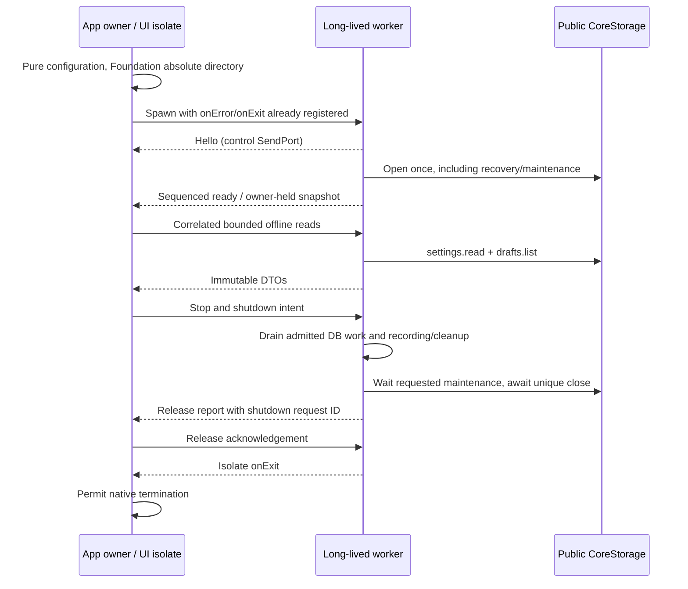

# Flutter host contract (1D.1)

## Status and reviewed baseline

Phase 1 / 1D / Step 1 fixes the Flutter UI scope and host responsibilities for
subsequent implementation. This is a design contract for reviewing 1D PRs, not
an implemented Flutter application or a new software, release, or hardware
acceptance record.

The November 12, 2026 source review used a clean `master` worktree at
`28225425f1596cc6ce25765fc6b92768a57fc79b` (PR #26, the 1C.9 merge). It exactly
matches the requested reference baseline. The configured origin is
`https://github.com/007pig/meshchan.git`; the local `origin/master` tracking ref
also points to that commit. This is a local checkout observation, not a fresh
remote CI or distribution check.

The [root workspace](../../pubspec.yaml) contains `packages/meshcore_link`,
`packages/meshchan_core`, and `apps/meshctl`, all at `0.1.0-dev.3` with
`sdk: ^3.13.0`. There is no `apps/meshchan_app` member or Flutter platform
project. Database schema/snapshot 1 and diagnostic summary format 1 are real
current baselines. Adding a UI alone needs no database migration. This step
changes no manifest, dependency, lockfile, generated file, schema, or version.
`0.1.0-beta.1` is a later 1D delivery target, not this step's version or a claim
that public distribution is ready.

Use these sources together; implementation details are evidence, not permission
for the Flutter host to import private code:

| Source | Current facts carried into this contract |
| --- | --- |
| [1C handoff](../releases/phase-1c-dev3.md#handoff-to-1d), [offline contract](offline-core.md), and [core host guide](../../packages/meshchan_core/README.md) | Committed saves, exclusive ownership, nullable results, recovery, privacy, and independent finalization. Early 1C.1 statements about absent packages describe that document's historical baseline. |
| [Public core entry](../../packages/meshchan_core/lib/meshchan_core.dart), [repositories](../../packages/meshchan_core/lib/src/repositories.dart), and [values](../../packages/meshchan_core/lib/src/values.dart) | Actual exported repositories, revision/cursor contracts, settings, history filters, and page bounds. |
| [Storage](../../packages/meshchan_core/lib/src/storage/storage.dart) and [recording](../../packages/meshchan_core/lib/src/recording/recording.dart) | Calling-isolate execution, admission/close barriers, prepared-before-transport ordering, observable recording Futures/streams, and quarantine. |
| [Preset models](../../packages/meshchan_core/lib/src/models/connection_profile.dart), [request types](../../packages/meshchan_core/lib/src/models/effective_parameters.dart), and [resolver](../../packages/meshchan_core/lib/src/parameter_resolver.dart) | Complete operation presets, presence-sensitive overrides, immutable effective parameters, and validation without device I/O. |
| [Session contract](../protocol/companion-session.md) and [finite tasks](../protocol/diagnostic-tasks.md) | Single-use sessions/transports, exclusive task ownership, existing deadlines, one inbox consumer, and actual cleanup. |
| [CLI guide](../cli.md#offline-business-commands-and-storage-1c8), [development guide](../development.md), and [testing guide](../testing.md#evidence-limits) | Host policy reference, current toolchain/native restrictions, sequential shared-asset checks, and evidence boundaries. CLI JSON is not the UI business API. |

There is no source conflict requiring a change to core. The missing host
mechanisms and observation limits are assigned below to later steps. Dated
1A/1B/1C CI, archive, native, and hardware results retain their original inputs
and limits; they do not validate a Flutter worker, release build, or GUI at this
HEAD.

## Product scope and decision status

The first release has three primary pages: **Drafts**, **Device**, and
**Diagnostics**. History is a Diagnostics subtab or detail entry; Profiles and
settings is an auxiliary entry available without a device.

| Page or entry | Required 1D behavior |
| --- | --- |
| Drafts | Bounded list, create, edit, explicit save, revision-checked delete, body UTF-8 byte count, and unsaved-edit handling. |
| Device | Explicit serial refresh and port selection, finite initialization/info check, cancel/disconnect, real current state, and a timestamped last-check snapshot. |
| Diagnostics | Single PING and finite Responder, **Start and record**, cancel, honest observable phases, and independent results. |
| Diagnostic history | Recovery/result details, existing filters, bounded cursor pages, protected deletion, maintenance status, and one-page redacted summary export. |
| Profiles and settings | Manage complete send/listen/ping/respond presets by type and ID, default preset, and history retention count. |

PING and finite Responder are the required initial execution entries. Both use
`CoreStorage.record()` behind the explicit **Start and record** action. 1D does
not design a second unrecorded GUI orchestration path. Existing CLI opt-in
`--record` and unrecorded behavior keep their current contract. Send/listen
presets remain fully editable and recognizable even though these operations
have no required first-release GUI execution entry; they are never converted
implicitly into PING or Responder.

Draft save uses a button and macOS Command+S. Autosave is not required. Drafts,
profiles, settings, and history work without a device. Opening storage, editing
a draft, resolving a preset, or viewing history must not construct a transport,
consume the inbox, or send radio traffic. Merely launching the app does not
start a device check or diagnostic.

The supported 1D product target is **macOS arm64 + USB**. Later 1D Android/iOS
work is limited to build, native dependency, and BLE integration risk checks;
it is not BLE support or complete mobile usability. Publishing, signing content,
article identity, long-content chunking/resume, decentralized synchronization,
persistent background radio tasks, and a product openHop entry are outside 1D.
1E takes formal distribution preparation within its existing scope.

| Decision or capability | Status in this step |
| --- | --- |
| Three primary pages and the two auxiliary entries | Adopted 1D scope decision. |
| Explicit draft save and GUI Start and record | Adopted interaction decision. |
| Finite device check, fresh diagnostic session, one device operation | Adopted ownership decision. |
| Long-lived worker owns core/native resources | Adopted design direction; actual worker, FFI/hooks, and debug/release execution require 1D.2/1D.3 verification. |
| Reuse the CLI macOS data directory | Adopted compatibility target; Bundle identifier, Sandbox, actual directory resolution, and authorization require 1D.2/1D.3 verification. |
| Release native libraries, directory access, and system file dialogs | Future platform checks; no Flutter execution has passed here. |
| GUI round trips and physical unplug | Future macOS/USB/LoRa checks; historical hardware evidence remains separately bounded. |
| Beta version and formal distribution | Future delivery targets; no version, tag, release, or distribution action in 1D.1. |

A future end-to-end user acceptance flow is: launch with no device, create a
Chinese/emoji/multiline draft, save explicitly, and reopen it; manage a PING or
Responder preset and settings offline; refresh ports and explicitly select a
USB path; run a finite info check and see **Not connected** after actual close
with the dated info snapshot retained; actively choose Start and record for a
bounded diagnostic; inspect logical, cleanup, save, and maintenance outcomes;
quit normally; restart with no automatic device access, reopen the exact saved
draft and recorded/recovered history, filter one history page, and export its
redacted summary through a system file dialog. This flow is a later acceptance
requirement, not an executed scenario in this step.

## Package boundaries and host structure

| Module | Responsibility and dependency direction |
| --- | --- |
| `meshcore_link` | Protocol, serial/transport access, single-use sessions, and finite diagnostics. No Flutter, business database, or dependency on `meshchan_core`. |
| `meshchan_core` | Drafts, presets, settings, typed resolution, recording, storage, recovery, history, retention, and safe export. Depends one way on public `meshcore_link`. |
| `meshctl` | Existing CLI host, terminal/file output, explicit per-invocation port/directory selection, signals, and process lifetime. |
| Future `apps/meshchan_app` | Flutter Views/ViewModels, platform resources, file dialogs, and application-level execution/lifecycle coordination using both public package entries. |

The Flutter host calls public core APIs directly in its worker. It must not run
a CLI subprocess, parse CLI JSON as business data, import
`apps/meshctl/lib/src`, operate Drift generated rows/internal SQL, or use test
`StorageHooks`. The CLI is a semantic reference, not a reusable UI adapter.

Use View + ViewModel + an application-level run controller. Initial state
notification uses Flutter's `ChangeNotifier`/`ValueNotifier` or similarly simple
built-in mechanisms with constructor injection. Do not introduce a state
management framework, generic RPC framework, or empty adapter package for this
contract. The run controller lives longer than any page.

### Worker ownership and control

Use **one long-lived business worker isolate** for the application session:

| Main isolate | Business worker isolate |
| --- | --- |
| Widgets, ViewModels, text editing buffers, platform directory resolution and authorization, system file dialogs, and host file writes. | The unique `CoreStorage` handle, device-operation controller, session, transport, finite task/`RecordedOperation`, cancellation, cleanup, save, and maintenance coordination. |
| Typed requests and immutable result snapshots; application-level status that remains visible across navigation. | Native resources stay in their creating isolate; project safe values/errors into snapshots before sending results. |

Current core performs synchronous directory creation/identity/ownership,
preflight, and native SQLite work on its calling isolate. Its asynchronous API
does not make the Flutter UI nonblocking automatically. `SerialPorts` also has
synchronous native work. Moving this work to the long-lived worker is the
adopted design, not an already tested Flutter runtime capability.

Never send `CoreStorage`, a repository handle, session, transport,
`RecordedOperation`, Future, subscription, or native exception object across
isolates. Keep resources on their opening isolate and send typed, immutable,
sendable values or controlled error codes. Ordinary local business views may
carry necessary draft/preset text; this does not make those snapshots safe to
log or export. Do not start a temporary isolate per CRUD call or open one
database per page.

The following are message categories and required state, not new core API names
or a frozen general-purpose serialization protocol:

| Category | Required coordination |
| --- | --- |
| Open and offline requests | Explicit resolved directory; bounded query/CRUD/resolution; committed result or safe failure, with request correlation. |
| Device requests | Refresh, explicit selection, finite check, or Start and record; acquire the application device gate before asynchronous work. |
| Control requests | Cancel/stop, status query, and quit intent remain receivable while long operations are pending. |
| Observations | Run ID or host run generation, recording milestones, real cleanup/save/maintenance facts, and latest application/owner state. |
| Shutdown | Admission stopped, accepted work draining, close confirmed or fault/unconfirmed; worker termination only after the required barrier. |

Only one device operation may be admitted at a time, including a check that is
still cleaning up. Acquire the gate synchronously **before** open/resolution or
other asynchronous work can admit a competing request. Core's recording
admission protects storage lifetime; it is not a replacement for this host gate.
Enumeration refresh must also be coordinated with active device work and never
select a port as a side effect.

Do not implement the worker as a message loop that awaits `operation.done`
before reading the next message. Register completion observers/continuations
separately from control dispatch, so cancel, status, and quit requests can be
handled while device/cleanup Futures are pending. Attach error observers to
accepted asynchronous work and retain the owner until real settlement.

Use request IDs, a run generation, and page-load/filter versions (or equivalent)
to reject stale completions. A late result can update its own application run
record, but cannot overwrite another run, draft editor, port selection, or newer
history page. Navigation does not close storage or stop an application task.

Synchronous preflight/native calls cannot be immediately preempted by a cancel
message. The main isolate can retain stop intent; the worker applies it at the
next processable control point. Recheck a received/latched stop after open or
parameter resolution and before recording/device admission and creation of a
new transport. During registration use the existing operation cancellation
gate so a stop observed before device work prevents startup. Do not promise
that an unprocessed message interrupts a synchronous factory/native call.

Worker failure, an unexpectedly lost response, or unconfirmed resource closure
must become an explicit application fault with unknown ownership where needed.
Do not automatically spawn another worker, reopen the same directory, or claim
resources were released because a worker stopped responding. 1D.3 must verify
stop/control delivery and fault presentation with the actual worker lifecycle.

## Data directory and storage lifecycle

The host supplies an explicit directory; core does not derive one from cwd,
the source checkout, or the app bundle. Separate these two platform concerns:

| Concern | Contract |
| --- | --- |
| Compatibility target | The existing CLI macOS default is `~/Library/Application Support/meshchan`, containing schema-1 `meshchan.sqlite`. The GUI targets the same existing 1C data. |
| Access mechanism | Unverified for Flutter. 1D.2/1D.3 must check the actual Bundle identifier, App Sandbox/container behavior, platform directory result, and file authorization in debug and release. `path_provider` must not be assumed to return the CLI directory. |

If the chosen platform setup requires a different directory, revise this
contract and specify existing-data continuity before using it. Never silently
create a second empty database that appears to replace existing data. Tests and
the second endpoint use explicit independent directories. The first release
may restrict explicit directory override to startup configuration; switch only
after the previous owner has confirmed close, never by keeping two handles.

One directory has one owner, including business reads. A GUI holding storage
can cause same-directory CLI queries, export, or finite diagnostics to fail
with `data_directory_busy`; there is no concurrent read-only exception.
Contention occurs before recovery, so a losing instance cannot archive a live
owner's runs. Do not delete `.meshchan.owner.lock` to force an unlock, treat the
informational marker as the lock, bypass ownership, or automatically copy a
live database and its sidecars. Core's existing locked preflight policy remains
unchanged; it is not a host backup facility.

Normal startup proceeds as follows:

1. Resolve/authorize the intended directory on the main isolate and start the
   worker/control channel with device selection empty for this app session.
2. In the worker, call `CoreStorage.open(dataDirectory: ...)` once. Core acquires
   ownership, preflights/opens schema 1, verifies the connection, and recovers
   incomplete records before returning a usable handle.
3. Inspect independent startup maintenance facts. A later maintenance failure
   can coexist with a usable open handle; it does not undo successful recovery.
4. Load bounded initial offline views. Enable recorded device actions only when
   storage and the run gate allow them and the user has selected a port. Do not
   enumerate/open devices or rerun recovery as a consequence of page queries.

Opening and page failures use distinct host presentations, not invented
`StorageState` enum values:

| Observation | Required presentation/action |
| --- | --- |
| Opening or generic `storage_open_failed` | Show opening or a directory/native/open failure; never claim data was saved. |
| `data_directory_busy` | Show directory in use; leave the other owner and files alone. |
| `unsupported_database_version` | Explain that a newer schema is unsupported; preserve files and stop business admission. |
| `database_corrupt` | Show damaged/incompatible stored data; preserve originals, without automatic rebuild. |
| Read/write/commit failure | Retain editing and previously committed facts; show the failing operation independently. A higher summary format can be `storage_read_failed`, not a newer database schema. |
| `StorageState.closeUnconfirmed` or `CoreException.cleanupUnconfirmed` | Show unconfirmed release alongside the primary error; quarantine uncertainty and do not automatically reopen. |

Never delete/rebuild on failure or substitute an in-memory database and display
**Saved**. Open and saves can succeed while independent maintenance fails.
Current public storage states are `open`, `closing`, `closed`, and
`closeUnconfirmed`; host opening/busy/fault states are UI coordination states.
Repeated core close shares the same Future/failure and does not force release.

Normal exit follows the [shared quit sequence](#normal-quit-and-desktop-behavior).
Core close stops new admission, waits for already admitted work and recording
continuations/maintenance, actually closes the native database, then releases
directory ownership. Retain the history reference to inspect its memory-only
maintenance getters after close; do not issue repository/maintenance calls once
close begins. Force quit/process crash provides no guaranteed callback, cleanup
save, or preservation of uncommitted editor buffers. Only already committed facts
and the existing next-open recovery contract can be relied on.

## Explicit device selection and finite checks

The Device flow is **select port -> create and initialize a finite check
session -> read info -> await actual close**. It uses the public
`SerialPorts.listPorts()`, `SerialTransport`, and `MeshCoreSession` APIs from
[meshcore_link](../../packages/meshcore_link/lib/meshcore_link.dart), with
`connect()` returning the existing info snapshot. It is not an indefinitely
connected dashboard and does not enable inbox reception for an info check.

Keep these independent display values:

| Value | Meaning |
| --- | --- |
| Selected port | Exact path explicitly selected by the user during this application session; changing selection does not retarget active work. |
| Current check state | Actual opening/initializing/ready/closing/failure and cleanup facts, observed from the owned session. Failed does not prove release. |
| Last-check info and time | Immutable historical snapshot with its observation time and source selection, retained after close or a later failure; it is not evidence of a live connection. |

After confirmed finite close, show **Not connected**, retaining the dated
snapshot. If cleanup is pending/failed/unconfirmed, show that real state rather
than pretending a normal disconnect. Cancel or Disconnect requests session
close during the check and waits for its actual cleanup. A stale check result
cannot relabel another selected port's state or snapshot as current.

Before a diagnostic, the old check must have released its resources. Each
diagnostic uses a fresh, unused transport/session exclusively owned by the
existing task/recording coordinator. Pass a lazy transport factory to
`CoreStorage.record()`; do not preconstruct or reuse the check transport or a
closed session. After the diagnostic there is no automatic check reconnection.

`portHint`, a default profile, history, or a last-launch selection never grants
device access at startup. A user's explicit port selection in the current app
session can serve later actively requested checks/diagnostics without repeated
confirmation dialogs. Do not auto-select the first enumerated port or treat its
path as stable device identity. Require explicit refresh/selection when needed;
no automatic reconnect, resend, enlarged budget, or radio reconfiguration.

`ready` means the existing initialization completed, not authenticated identity
or a verified wireless round trip. Initialization timeout is distinct from
remote PONG timeout. Preserve the existing request/initialization/startup/task
budget semantics and no-retry policy. Current native platform guards still
apply: the pinned serial backend blocks native enumeration on Linux/Android/
Windows and native port checking on Windows. A Flutter build does not remove
those guards or prove device access on another platform.

## Draft editing and explicit saves

Keep three distinct values in a draft editor: the current editable buffer, an
immutable in-flight save snapshot with its edit generation, and the last
committed `Draft` including revision. New text remains unsaved until a core
mutation returns after commit. Serialize saves/deletes for an editor so repeated
Command+S or a second window cannot accidentally race its own revision.

When saving snapshot A while the user types B, success advances the committed
baseline/revision to A but must not replace B or mark B saved. The next save
uses the returned revision with a fresh snapshot. Save failure retains the
buffer and last committed baseline. Late results are associated with the
correct editor/request, including after navigation.

Use `DraftRepository.update()` and `delete()` with `expectedRevision` from the
committed version. On `conflict`, retain edits and show an explicit conflict;
reading the latest version for user resolution must not automatically retry an
overwrite with its newer revision. Stale identical content still conflicts.
Handle `not_found` separately from a successful delete/save.

Empty titles/bodies, Unicode, whitespace, and newline sequences follow core's
exact preservation rules, with no trimming, normalization, or truncation.
Unpaired UTF-16 surrogates are invalid input at persistence; valid emoji and
combining text remain exact. Label the derived count **Body UTF-8 bytes** using
the core content model's meaning, not characters/code units or remaining LoRa
capacity. A draft can exceed one datagram and still be saved.

Leaving an editor with unsaved changes offers Save, Discard, or Continue
editing. Save waits for commit and rechecks that no newer buffer remains dirty
before leaving. Save failure or a canceled departure retains the editor. A
save completion/state refresh must not repeatedly reset `TextEditingController`
text, selection, or the input method's composing range. Apply intentional
document loads separately from routine status notifications.

Current repositories expose no public watch stream. Refresh the affected row
or bounded list after completed operations and on explicit refresh, with load
generations to reject stale pages. Draft/profile lists default to 50, allow
1..200, order by `updatedAt DESC, id DESC`, and use `UpdatedCursor`. Separate
pages are not one snapshot; do not assume offset pagination or an unlimited list.

## Presets, settings, and form presence

Select profiles by ID; duplicate names are valid. Manage all four types with
complete operation-specific parameter replacements, preserving the shared
budgets and `portHint` plus the applicable channels, route/path, data type/filter,
test endpoints, duration/response timeout, entry limit, and response limit.
Use the existing typed models/validation rather than dropping fields absent
from the initial execution pages. An intentional type edit replaces/clears
incompatible fields atomically; merely selecting a send/listen preset cannot
change a PING/Responder invocation's operation.

Per-run send payload/PING content is not stored in a preset. Settings remain
exactly `defaultProfileId` and `diagnosticHistoryLimit` (defaults null/1000;
history range 1..100000, no clamping). Settings save replaces both fields;
preserve the other field when changing one. `restoreDefaults()` explicitly
restores both defaults. Profile deletion clears a matching default atomically
without altering historical snapshots. Profiles/settings have no revision
contract: use a single editing flow and serialized writes, not invented
optimistic-lock tokens or silent stale full-object replacement.

Resolve execution using `CoreStorage.resolveParameters()` and the actual typed
request/override classes. Priority is **explicit invocation value -> selected
or default profile -> existing program default**. Display inherited values
without marking every initialized text box as an explicit override. Track
presence separately from rendered text and lexical validity.

| Input distinction | Current core meaning to preserve |
| --- | --- |
| Omitted override vs zero | Null inherits; valid explicit zero remains zero (for example startup delay/channel/descriptor). |
| Omitted route path vs empty list | Omitted inherits; explicit empty replaces the path. Descriptor/path merge independently, so changing the descriptor does not implicitly clear inherited path. |
| Missing invocation content vs empty bytes | Send/PING still need invocation content; an explicit empty byte list is valid subject to normal validation. |
| Omitted listen filter vs clear vs type 0 | Null override inherits; `DataTypeOverride(null)` clears; `DataTypeOverride(0)` selects zero. |

An explicit profile ID bypasses unrelated default selection. Missing references
fail `not_found`, mismatched operation fails `invalid_input`, and damaged stored
profiles fail `database_corrupt`; do not repair through overrides or fall back
silently. Required fields without program defaults stay required. Core's public
route/capacity validation and cross-field checks precede transport construction.
Text/hex lexical parsing belongs to the host without importing CLI internals.

Freeze `EffectiveParameters` for the invocation after resolution. Later preset
edits/deletion cannot change an active run. This value can contain raw content,
exact route paths, and endpoint labels; it is not a safe summary. Never log it
wholesale or export it as diagnostic history.

## Recording observations and independent results

Observe only the actual public `RecordedOperation` contract:

| Observation | Meaning for the GUI |
| --- | --- |
| `prepared` | `RecordingSave` for registration. Only committed preparation permits the lazy factory; success proves registration, not device open, send, or delivery. Failure means no device work, null logical result, and later required saves `notAttempted`. |
| `logical` / `logicalSaved` | Frozen typed task result (nullable if registration failed) and its independent commit outcome. Available without waiting for native release. |
| `cleanupUpdates` / `cleanupDone` | Cumulative real core/host cleanup observations and the final observed cleanup summary. Known failures can coexist with pending/unknown release. |
| `saveUpdates` / `cleanupSaved` | Completed persistence attempts, including intermediate cleanup snapshots; `finalCleanup` distinguishes a terminal cleanup save from a committed pending snapshot. |
| `done` | `RecordedResult` with logical, cleanup, registration/logical/cleanup saves, save attempts, and any coordination failure. Await it for the operation's settlement, not as a whole-application close/export result. |
| `cancel()` | Requests existing task/session cancellation and returns the logical Future. It neither retracts radio effects nor confirms actual cleanup. |

Attach observations promptly; do not assume a broadcast stream replays earlier
events. Keep the named Futures/final result as authoritative phase outcomes.
Before preparation commits, the factory must not create a transport. A failed
registration cannot be displayed as a started device operation. The worker's
factory supplies a new transport for the captured explicit port and the actual
host version is passed as `appVersion`, not the planned beta label.

The recording API exposes no full connection-stage or per-packet progress
stream. Display truthful host phases such as Registering, Running, Result
available, and Settling, plus received cleanup/save details. Running does not
assert ready, transmission, or remote receipt. Do not invent percentages,
consume extra inbox entries, subscribe to raw transport frames, add a raw read
loop, or operate the recording-owned session to manufacture progress.

The same result presentation may serve live runs and history, while retaining
which facts are live observations and which were actually saved. Preserve these
independent dimensions rather than one success/failure badge:

| Dimension | Required distinctions |
| --- | --- |
| Task outcome | Operation, reason/stage, controlled failure, and nullable/partial facts. Cancellation and an earlier committed session fault keep their core meanings. |
| Local send and remote match | Attempted/dispatched/write/OK/acceptance are distinct; local acceptance does not prove remote receipt. PONG observation/content validation and successful RTT are separate. |
| Cleanup | Core and hostSubscriptions scope states/failures, aggregate, and unconfirmed/pending release. Task-internal cleanup is not registered again as host cleanup. |
| Persistence | Each required save's committed/failed/notAttempted state, safe error, and final cleanup flag; no inference from the current UI text. |
| Maintenance and application finalization | Independent latest/sticky maintenance, eventual database close/owner release, and host file output. These are outside the recorded task's logical result. |

Null/unknown, false, and zero are not interchangeable. False acceptance does not
prove zero bytes or zero RF. A matching PONG followed by local write failure
retains match/content/first-observation facts while `roundTripSucceeded` can be
false and application RTT null. Logical success remains true if later cleanup
or save fails. A normal Responder with zero replies establishes no wireless
round trip; response attempts and local confirmations are distinct, and a local
confirmation does not prove the peer received PONG.

Save failure preserves already observed wireless facts, continues safe cleanup,
and never triggers resend. Unsaved facts may be unavailable after exit. A
returned cancel or logical result must not reopen the device gate while actual
cleanup remains pending. A completed `done` with unconfirmed device release
also leaves the gate blocked with an explicit fault; Future completion alone
does not establish release. Application database close happens at host exit,
not after each diagnostic. `RecordedResult.fullySuccessful` covers its defined
logical/cleanup/required-save conditions only; it excludes subsequent maintenance,
storage close, and file export and cannot be a whole-app success flag.

## History, recovery, maintenance, and export

Use `DiagnosticHistory.query()`/`read()` with `HistoryQuery`: operation, record
state, inclusive `preparedFromInclusive`, and exclusive `preparedUntilExclusive`,
combined with AND. Times filter UTC registration (`preparedAt`), not recovery or
logical end. Default page size is 50, allowed 1..200 via `PageSize`; order is
`preparedAt DESC, runId DESC` with `HistoryCursor`. Retain the cursor used to
load each page and reset it when filters change. `nextCursor` means more items;
separate calls share no snapshot and do not require the cursor row to survive.

Recovery has completed before open returns, not on every history read. An
interrupted prepared record is archived without inventing a task end or wireless
failure; known partial/cleanup facts survive. A saved logical result with
unresolved cleanup keeps its result/end time while only unresolved scopes become
`unconfirmed_after_exit`. Terminal cleanup, including actual failures, remains
terminal. Already archived records keep the first recovery observation.
Recovery never replays PING, resumes Responder, reads inboxes, or proves that a
previous process completed cleanup.

Core protects active pins and records with ineligible/unsettled cleanup from
deletion/retention. Use `delete()` and display `conflict`; no force delete.
Recovered archives are eligible under existing rules, as are settled records
whose two scopes are terminal, including terminal failures. Retention may
legitimately leave total history above the limit while records are protected;
drafts are not subject to history pruning.

`maintain()` requests bounded core maintenance; `waitForMaintenance()` waits
for already requested work without retrying failure. Present `completed`,
`deferred`, and `failed` with committed deletion/deferred counts and nullable
limit. Deferred is normal protection, not failed cleanup or a reason to delete
another row. Maintenance failure is independent of an already committed open,
settings save, or diagnostic result. It can include earlier committed batches.

Inspect `latestMaintenance`, `unacknowledgedFailure`, and
`unacknowledgedFailureCount` at relevant completions and before shutdown. Later
successful automatic work does not clear sticky failure. Clear it only through
an explicit acknowledgment using `acknowledgeMaintenanceFailures()`, not by
refreshing a page. This is bounded handle-lifetime memory, not a persistent
failure log. `done` does not itself prove final unpin-triggered maintenance has
settled; core close remains the final drain barrier for these continuations.

The initial export action is **Export one page of redacted summaries for the
current filter**. Call `exportSummary()` with that filter, page size, and the
cursor used to select the current page; write its returned safe JSON verbatim.
Show the returned run count and whether its `nextCursor` indicates more, outside
the JSON. The export is a fresh bounded selection and may differ from an earlier
screen query; describe the exported selection accurately, without promising a
cross-call snapshot or silently fetching every page.

Use the core JSON allowlist, never an arbitrary page-object serialization. It
excludes profile/local port information, exact route paths, endpoint labels,
device details, content, nonces, keys, credentials, and raw exceptions/stacks.
Do not append any of these to the file. The format is a summary, not a database
backup or import/restore format; 1D adds no full-export/backup system.

The main isolate owns the file dialog, cancellation, and writing the selected
file. Distinguish summary-generation success from destination/write failure;
an incomplete/failed file cannot be labeled exported successfully. File errors
do not alter diagnostic or historical facts. Stored instants stay UTC; local
display conversion never rewrites them. Keep `recoveredAt` distinct from
`logicalEndedAt`, and preserve integer elapsed/RTT microseconds rather than
recomputing them from wall-clock display times.

## Normal quit and desktop behavior

Window close and Command+Q must converge on one application quit coordinator.
The actual macOS events and veto/defer behavior require later platform testing;
do not assume every exit follows one Widget callback. The normal sequence is:

1. Stop accepting new user operations, retaining the current run/owner and
   control channel. Already admitted work remains observed. Reserve controlled
   admission for the quit coordinator's save decision below; do not begin core
   close yet.
2. Resolve unsaved edits with Save, Discard, or Continue editing/cancel quit.
   Save must settle and newer edits must be considered. If quit is canceled,
   restore normal admission only when storage is still open and the existing
   device gate permits it; do not duplicate a run or undo committed facts.
3. Cancel or finish active device work. Request close for an active check or
   `cancel()` for a recording, without mistaking logical completion for release.
4. Await actual resource cleanup and necessary recording saves/`done`. Keep
   failures visible; pending cleanup has no invented release deadline.
5. Wait for relevant requested maintenance and accepted database operations to
   settle. Observe already accepted export/file work as separate host output.
6. Await `CoreStorage.close()` for actual native close and directory release.
   Its admission barrier also covers recording's final unpin/maintenance. Read
   retained memory-only maintenance status to expose any later failure.
7. After confirmed release, end the worker and application. Failed/unconfirmed
   close remains an explicit fault, not a successful normal exit or permission
   for automatic replacement ownership.

If no handle/device was acquired, the corresponding wait is not required; an
open failure with `cleanupUnconfirmed` still retains its uncertainty. Do not
retry open to test whether an ambiguous owner was released. A user may force
termination at the platform level, with only committed facts and restart
recovery promised.

Page navigation, loss of focus, and minimization are not quit. Never launch
unawaited critical cleanup from ordinary Widget `dispose`. While cleanup is
pending the UI remains responsive, showing known results and current stop state,
but cannot admit a competing device operation. A failure during cleanup,
maintenance, close, or file output does not rewrite a committed task/save result.

Later desktop acceptance includes Chinese input composition, emoji, multiline
text, undo/redo, Command+S, window resizing, keyboard navigation, and readable
long error messages. Platform file dialogs and error views must expose the
controlled failure plus actionable context without dumping native exceptions or
sensitive device/business content into general logs.

## Future scenario acceptance matrix

These are future checks, not test implementations or passing results from
1D.1. Controller checks use controlled completions/fake device boundaries;
real-file integration verifies actual ownership, commits, close, and recovery.
Actual macOS/USB checks establish platform/native behavior that those layers
cannot prove. Keep separate test processes and native builds sequential as in
the [testing guide](../testing.md); shared native assets are not isolated by
using different business directories.

| Scenario | Required observation | Main future verification layer |
| --- | --- | --- |
| No-device launch and draft reopen | No transport/enumeration/inbox access; exact committed Unicode/newline content survives normal close/reopen. | Controller + Widget; real-file integration. |
| Continue typing during save | Old completion advances only its committed snapshot/revision; newer text stays dirty and composing/selection is preserved. | Controller + Widget. |
| Stale revision on save/delete | Keep edits, show conflict, no automatic newer-revision overwrite. | Controller + Widget; real-file integration. |
| Mismatched preset or explicit empty/zero values | Core failure/merge rules apply; no fallback or operation conversion; initialized inherited text stays nonexplicit. | Controller + Widget with public resolver; real-file integration. |
| Same directory owned by CLI/another instance | Show busy before recovery; no forced unlock or mutation of the live owner's records. | Real-file/process integration; actual macOS app directory access. |
| Start diagnostic while info check cleanup is pending | Gate rejects/defers start; no competing connection or reused transport. | Controller with blocked cleanup; actual macOS/USB. |
| Initial registration commit fails | No factory/transport/device work; registration failure and null logical result remain distinct. | Controller + real-file integration. |
| Logical result exists while cleanup is pending | Show known result promptly, retain ownership/gate, and keep cancel/status/quit controls responsive. | Controller + Widget; actual macOS/USB. |
| Matching reply then cleanup or save failure | Preserve match/RTT/send facts as actually known; show independent failures; no resend. | Controller + Widget; real-file integration; actual USB/LoRa for real round-trip evidence. |
| Cancel, navigate, or quit during a task | App-level owner persists through real settlement; stale events cannot contaminate another page/run; canceled quit restores eligible admission. | Controller + Widget; actual macOS close/Command+Q and USB. |
| Restart recovery | Keep known/unknown facts and separate recovery time; no task replay, inferred wireless failure, or invented successful cleanup. | Real-file/process integration + Widget. |
| Export/write or maintenance failure | Keep committed diagnosis; show independent output/sticky failure, correct page count/more indicator, no false export success. | Controller + Widget; real-file integration and actual macOS dialogs/file writes. |
| `closeUnconfirmed` or worker fault | Show uncertain release, keep fault visible, no automatic new worker/owner takeover. | Controller with fault boundaries; real-file/process integration; actual macOS lifecycle. |
| Desktop input/resize and physical unplug | Exact saved text/keyboard behavior and honest failure/cleanup; no promise that compile success proves safe unplug recovery. | Widget + actual macOS; actual USB unplug and LoRa in 1D.11. |

## Implementation gaps and step handoff

The existing public business APIs cover this scope. These host mechanisms or
observation limits remain concrete later work; no private bypass or fictitious
core API is implied:

| Gap or limit | Assigned response |
| --- | --- |
| No Flutter member, platform runner, or verified Flutter native assets | 1D.2 adds the workspace/runner and verifies serial/SQLite hooks, FFI loading, and debug/release assets using the existing SDK. |
| CLI-compatible path is a target, not a verified Flutter directory result | 1D.2/1D.3 establish Bundle identifier/Sandbox/access authorization, actual existing-data path, and explicit startup override behavior. Revise the contract before any necessary relocation. |
| No worker bridge, app device gate, or unified desktop quit coordinator | 1D.3 implements typed request/snapshot exchange, unique owner, nonblocking control dispatch, stale-result protection, stop checkpoints, and failure handling; 1D.9 verifies platform quit integration. |
| No repository watch streams or profile/settings revisions | 1D.4/1D.5 use bounded targeted refresh and serialized editing; do not invent watch/CAS methods. |
| Recording lacks connection/per-packet events and a final-unpin notification | 1D.7 shows only public milestones/results; 1D.8/1D.9 observe existing maintenance reports and use close as the final drain barrier. Richer progress would need a separately reviewed public core change. |
| Export returns JSON plus next cursor, without a count field/file writer | 1D.8 derives count only from the returned safe JSON `runs` array for UI metadata, preserves JSON bytes/fields, and owns dialog/file errors. No new export envelope/API is assumed. |

| Step | Bounded implementation responsibility |
| --- | --- |
| 1D.2 | Flutter workspace and macOS host; debug/release native assets, Bundle identifier, Sandbox/directory-access platform validation. Use `/opt/homebrew/share/flutter` and its bundled Dart on the current Mac; no second SDK, upgrade, or channel switch. This local path is not a universal environment requirement. |
| 1D.3 | Long-lived worker, unique storage owner, device gate, stop/control responsiveness, lifecycle/fault coordination, and actual native operation on the chosen isolate. |
| 1D.4 | Draft list/editor, commit/revision handling, explicit save, and dirty-buffer navigation. |
| 1D.5 | Complete typed presets/settings and presence-sensitive form/resolver integration. |
| 1D.6 | Explicit USB selection, finite info check, timestamped snapshot, and real cleanup state. |
| 1D.7 | Recorded PING/finite Responder, cancellation, honest progress, and independent outcome presentation. |
| 1D.8 | Filtered/paged history, recovery/maintenance presentation, protected deletion, and one-page safe export. |
| 1D.9 | Desktop input/keyboard/resize behavior and reliable shared window-close/Command+Q shutdown. |
| 1D.10 | Sequential software/native regression, old schema-1 compatibility, and limited Android/iOS build/native/BLE risk checks, without a mobile support claim. |
| 1D.11 | Explicitly selected real USB/LoRa GUI acceptance, including failure/unplug behavior, and the beta delivery target with evidence tied to actual artifacts. |
| 1E | Formal distribution preparation within the existing scope; this contract grants no public release readiness. |

1D.1 completion is limited to API/contract review, local Markdown target/anchor
checks, full review of the new file and navigation diff, and whitespace/scope
checks including the untracked new document. It requires no dependency
resolution, generation, Dart/Flutter tests, native build, port enumeration,
device access, or RF action. Future acceptance above must be executed and
recorded in its owning steps; document review does not substitute for it.

## 1D.2 implementation note

The November 12–13, 2026 implementation adds `apps/meshchan_app` and a macOS
runner on the unchanged Flutter 3.47.9/Dart 3.13.7 baseline. The historical
1D.1 observations above remain its design-review baseline. See the
[platform record](../validation/phase-1d2-platform.md) for executed checks.
Normal launch and page navigation still create no core/native resources.

The official template enables App Sandbox in Debug/Profile and Release. A real
debug run resolved Foundation and Dart HOME to
`~/Library/Containers/org.meshchan.meshchan/Data`, returned container Application
Support, and failed an external fixture. This implementation deliberately omits
App Sandbox in **both** entitlement files. The selected development desktop host
retains direct access to the adopted CLI location and the future POSIX serial
backend, without a file-dialog/security-scoped bookmark bootstrap. It does not
add USB capabilities or prove device opening. Debug/Profile retain template
JIT/network-server development entitlements; Release requests none. Local signing
is ad hoc. No system security setting, keychain, SDK or vendor cache was changed.
This decision does not satisfy Mac App Store Sandbox requirements, Developer ID
signing, notarization or clean-machine distribution; those require later review.

The runner reports Foundation home/support and executable/bundle facts only in
the explicit developer mode. With Sandbox omitted, debug and release resolve the
compatibility target to `~/Library/Application Support/meshchan`. Independent
fixtures establish file access and persistence, including a separate sibling
validation directory under Application Support; no existing user database is
opened or migrated. 1D.3 must still implement unique application ownership,
production directory bootstrap/recovery, contention/fault behavior and any
explicit override/authorization coordination.

The finite probe owns all SQLite/native work in one temporary worker, waits for
maintenance and confirmed close before reopening, and uses an incomplete/closed
receipt to guard cross-process reads. It passes only sendable results to the UI.
It is not the long-lived worker, device gate, control bridge, cancellation,
stale-result protection or shutdown coordinator described above. Those remain
1D.3/1D.9 work. Business pages remain 1D.4–1D.8.

## 1D.3 implementation note

The historical notes above retain their original scope. The application now
implements the long-lived worker and basic native quit barrier. Actual inputs
and execution results belong to the [runtime validation record](../validation/phase-1d3-runtime.md).
No core/CLI behavior, schema, version, dependency or entitlement changes were needed.

`LaunchConfiguration` validates normal, legacy finite probe, bounded runtime
verification and native-test modes before resources. Default Foundation resolution
remains `~/Library/Application Support/meshchan`; `--data-dir` has precedence and
must be absolute/nonempty/NUL-free without dot segments. No directory fallback,
live-file copying, read-only owner exception or lock manipulation is implemented.
Native TestAction does not inherit ordinary launch arguments and supplies the
versioned disabled-owner configuration before engine construction. A detected test
host with missing/invalid configuration cannot enter production startup.

`RuntimeController` owns the client ports, subscriptions, startup, pending request
map, query version and single shutdown process with cached observations.
`WorkerDispatcher` owns the single storage handle, retained history reports, short database queue, device gate,
adapter and close. Only explicit value DTOs cross the bridge; neither worker entry
nor bootstrap captures UI/core/native objects. Ready means open actually returned.
Query errors leave that owner held. Host phases and unknown ownership are separate
from the real core `StorageState` and error vocabulary.

Every ordinary envelope has runtime generation and monotonically increasing
request ID. Worker rejects repeated/old IDs without executing them. Responses
remove their pending entry exactly once. Out-of-order reads remain available to
their callers but cannot replace newer shared data; sequenced snapshots cannot
regress state. Native exceptions/stacks are projected to controlled host categories.
Timeout/worker loss ends pending requests as unknown/fault, freezes admission and
never resends or replaces the worker. Release reports are correlated to the one
shutdown ID. Acknowledgement ensures a healthy worker cannot exit ahead of the
main isolate receiving its release proof. `onExit` without proof preserves unknown
ownership; a release report without exit still does not permit normal termination.
After a shutdown deadline, its unknown outcome remains an immutable observation.
Later matching release and actual exit facts, in either delivery order, dispose
client ports automatically and update the cached outcome for subsequent quit
requests. They never send stop/close again, resume admission, or change a timed-out
request into a committed result. Rejected `Isolate.spawn` creation is separately
confirmed resource-free, including if it rejects after an earlier startup fault;
it does not fabricate an onExit event. A created worker's fatal/exit path retains
unknown ownership until release is confirmed.

Client request/startup faults do not disable the first shutdown exchange to a
still-running worker. The close observation is allocated after startup settles,
separately from those earlier deadlines. Its correlated intent survives a missing
Hello and is sent once when the control port arrives, including after a shutdown
observation timeout. Ordinary admission stays faulted. A close deadline always
settles its own observation even if a previous fault was already recorded; actual
release/exit proof is still required. Fixture read verification also requires a
regular nonempty database before changing its receipt or starting an owner; it
never uses core open to initialize a replacement for an empty read fixture.

The device lease is acquired before the first async resolution/read. A second
operation is rejected synchronously. Worker uses real event-loop checkpoints before
open, before resolution and after resolution; observed stop prevents new admission.
After `record()`, cancellation immediately uses that operation's own gate. The
adapter observes all named Futures and streams on registration and repairs missed
broadcast events using authoritative final results. A done recording releases the
lease only when core, host and aggregate cleanup are all succeeded/notRequired and
no observation failed. Pending, failed and unconfirmed release is quarantined.
Logical/save/coordination/maintenance facts remain independent. Storage close is
still the final core admission/unpin/maintenance drain barrier.

Stop receipt and application are separate snapshot fields. Main preserves quit
while resolving/spawning/handshaking; AppKit also preserves a quit received before
Dart installs its handler. Stop cannot preempt synchronous Foundation/FFI calls;
it applies only after the event loop has actually received it. No code claims that
merely sending a message has canceled an unprocessed native call.

`pauseAdmission`/`resumeAdmission` form the reversible pre-close boundary. Resume
requires open storage, a free device gate and no close started; it does not undo
prior cancellation or commits. `shutdown()` is irreversible and shared by all quit
paths. It drains accepted work, waits real recording settlement and requested
maintenance, verifies core closed, snapshots the retained in-memory history reports,
reports release, acknowledges and waits for exit. Closing never starts new repository
queries. Ambiguous cleanup retains resources and a visible fault. After resource
bootstrap, the Swift delegate returns `terminateLater`, preserves the original
AppKit termination request and replies to it after Dart confirms or rejects exit.
It never cancels a healthy system logout/restart/shutdown and substitutes another
app quit. Forwarding is scheduled after the delegate returns, including when Dart
can answer immediately. Concurrent requests share the pending exchange.

`HostResourceBootstrap` gates runtime directory resolution/spawn and the finite
probe until the first frame has rasterized and native authorization is received.
That grant requires Dart's quit handler to be installed and no pending quit. Before
the grant, AppKit can return `terminateNow` without entering a pre-first-frame modal
loop or abandoning core resources; later authorization is denied. The explicit
startup-quit acceptance path forwards to Dart on the regular run loop, saving stop
before releasing the bootstrap wait. The controller then closes without resolving
a directory or creating a worker. A delayed frame or authorization response cannot
restart it. Native code only tracks the AppKit request and bootstrap fact; Dart
remains the single resource coordinator. Full dirty-edit and desktop interaction
policy remains 1D.9.

1D.4 should reuse `AppRuntime`/`RuntimeController`, `ReadOffline`, immutable draft
snapshots and explicit cursors. Add narrowly typed committed mutation requests and
per-editor revision/query versions; keep edit buffers and dirty decisions in main.
Do not import worker repositories or close the owner from a draft page. Device
selection, real diagnostic forms, complete history and export remain 1D.5–1D.8.

## 1D.4 implementation note

The product Drafts view uses typed `AppRuntime.listDrafts/readDraft/saveDraft/
deleteDraft` methods. The worker calls only public `CoreStorage.drafts`, through
its existing admitted database queue. `ReadOffline` remains the historical
bootstrap/verification API; settings errors do not gate the product draft list.
`CreateFixtureDraft` remains fixture-only. Schema, package versions, ownership,
serial gate and platform bootstrap/termination protocol are unchanged.

`DraftEditor` is a stable main-isolate document session. TextEditingControllers
hold the current buffer and input state, `PendingDraft` captures immutable
text/document/edit generations and expected revision, and `baseline` holds only
a confirmed read/commit. Exact buffer equality determines dirty. Save completion
advances baseline/ID without assigning controllers; an A commit leaves newer B
unsaved and the next update uses A's returned revision. Writes coalesce while
pending; delete cannot overlap save and disables document editing/selection.
Unknown is a retained mutation outcome, independently of later resource release.
Explicitly acknowledging local discard permits departure, without claiming rollback.

Document reads, stored-version inspection and bounded list requests have separate
generations. New selection/refresh/mutation invalidates stale results and cursors.
Mutation success remains successful if its independent first-page refresh fails.
Inspecting a conflict never updates the buffer or baseline; confirmed Reload does.
The title uses a bounded-height multiline field without a single-line formatter.
Body byte preview is recomputed only when body text changes. Valid noncollapsed
composing text defers every Save path; no clearComposing, delayed unfocus or
controller rewrites are used. Stable field/container keys preserve input connection
and focus when status/error controls are inserted. The form scrolls in narrow or
short windows instead of squeezing the body to zero height.

`DraftQuitCoordinator` is constructed at application scope and injected into the
view. The native requestQuit handler and Flutter onExitRequested share its one
in-progress Future. Cancel clears that attempt. BeginDraftDecision pauses host and
worker admission, binding a fresh decision generation to the current document
session. WriteDraft accepts that decision only once for the final captured save;
ordinary reads/writes/deletes and generic ResumeAdmission remain blocked. Accepted
prior writes drain and supply their actual returned ID/revision before capture.
Human decision time is outside worker RPC deadlines. EndDraftDecision resumes only
with open storage, no stop/close/fault and a free device gate; terminal uncertainty
cannot resume. Save RPC deadlines retain the existing unknown contract.

Only after the reversible decision succeeds does the coordinator call shutdown,
then the bootstrap stop callback. AppKit terminateLater/original-request replies,
first-frame/native authorization, release acknowledgement and actual onExit remain
the existing resource barriers. No editor/context is awaited for resource-free
early quit. Native sources and XCTest isolation did not need alteration.

The [1D.4 validation record](../validation/phase-1d4-drafts.md) separates software,
worker/process, native and actual GUI evidence. 1D.5 can reuse these typed runtime,
page/session and quit-decision boundaries for presets/settings, which still require
their own public models, validation and save behavior. Device selection, PING,
Responder, history/export and the full system-termination matrix remain later work.

### 1D.4 editor review corrections

Departure checks active composition before a modal, read-only transition or quit
admission await can make Flutter discard its composing range. Both fields retain
focus on outside pointer-down so the action checks live controller values even
before the next build. An unfinished composition defers this entire departure
attempt with a visible notice; it does not start the dialog, pause admission or
initiate shutdown. Natural candidate completion/cancellation permits a new attempt.

The editor form is keyed by document generation. Intentional document replacement
disposes Flutter's EditableText/UndoHistory state and any throttled history push;
Undo cannot restore another document's text into the current ID/revision. Save
completion and ordinary status/list changes retain that key, selection and history.

Each leave prompt captures the unknown flag actually displayed before awaiting
its answer. If an accepted mutation becomes unknown while a regular dialog is
open or while its chosen Discard waits for the write, a second unknown-result
prompt must be acknowledged. Continue editing at either prompt retains the buffer
and vetoes departure; resource release never changes the unknown mutation fact.

### 1D.5 implementation

The auxiliary Profiles and settings entry uses `ProfilesEditor` for a single
persistent Profile/Settings session, `ParameterForm` for complete parameters and
independent invocation presence, and `ParameterPreview` for explicit generation-
bound resolution. Public immutable core models cross the isolate boundary in
small typed replies. Core/link implementation, schema, dependencies, versions,
device and recording contracts are unchanged. The native composition follow-up
below includes a narrow Command+Q event-routing correction in the runner.

`AppRuntime` now exposes independent profile pages/reads/mutations, settings
read/save/restore and typed resolve methods. WorkerDispatcher routes them through
the same short database queue and owner. Core settings mutations themselves
request independent maintenance; worker observes completion and projects latest
and sticky facts without turning maintenance failure into save failure.

The historical `DraftDecision` wire name is retained for compatibility. It now
also identifies EditorTarget, document/session generation and stable target ID.
Both bridge sides reject ordinary paused requests and consume one final Save
before enqueueing it. Pending new-profile creation can bind only its own returned
ID; Draft writes also carry session identity. The existing DraftQuitCoordinator
owns both editors and preview and remains the sole native/Flutter quit decision.
The auxiliary form never accesses storage in Widget disposal.

See [the new validation record](../validation/phase-1d5-profiles-settings.md).
Earlier 1D.4 GUI evidence and its default-directory isolation incident remain
historical. Step 1D.6 must obtain independent, explicit port selection authorization;
profile selection, resolved parameters and portHint do not provide it.

### 1D.5 native composition follow-up

Actual native Pinyin testing exposed that DropdownButton's menu route can open
before onChanged checks composition, committing marked text on focus loss. The
profile/settings/preview selectors now use a small GuardedChoice: its button checks
live composing values before showMenu, and checks again before applying a choice.
It retains operation/ID/presence semantics and adds no persistence API. Five mouse
Widget regressions reproduce the original menu-opening failure and pass after the
fix. The app suite now passes 124 tests. Native evidence and the user-configured
Pinyin/ABC Caps Lock setup are recorded in the [1D.5 validation record](../validation/phase-1d5-profiles-settings.md).

The same actual-input run exposed a native Command+Q issue: after the Dart
coordinator deferred quit for active composition, Flutter's input method could
still insert `q` into the pending phonetics. MainFlutterWindow now consumes only
the unmodified Command+Q key equivalent before forwarding to Flutter and calls
the original AppKit terminate entry. The existing native request/reply,
composition veto, shared coordinator and shutdown barriers remain responsible
for the decision. Window close still uses the original windowShouldClose path.
Caps Lock does not prevent matching; Command+Shift/Control/Option+Q and other
shortcuts are not intercepted. Two native event-matching regressions accompany
the actual Pinyin/quit proof; no SDK, engine or security configuration changed.
